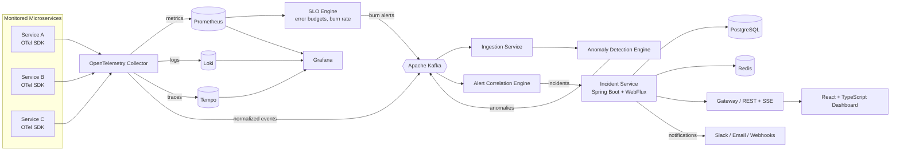
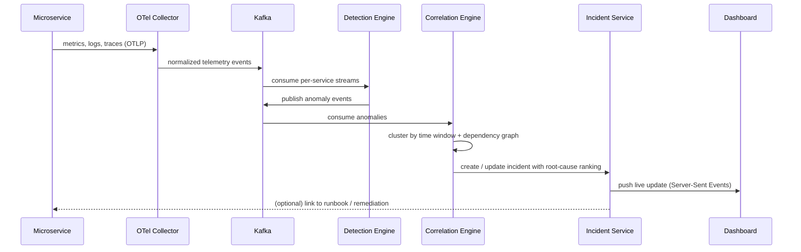
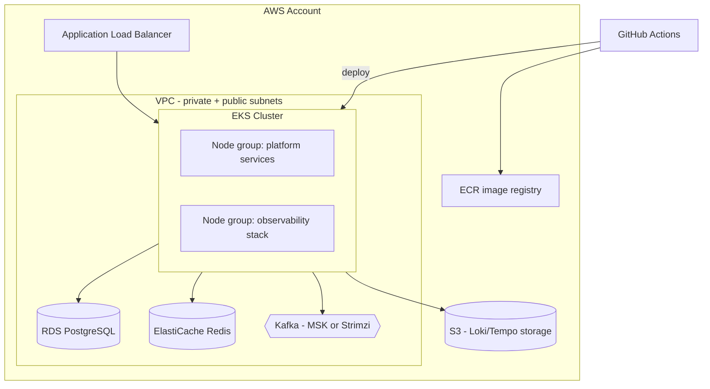
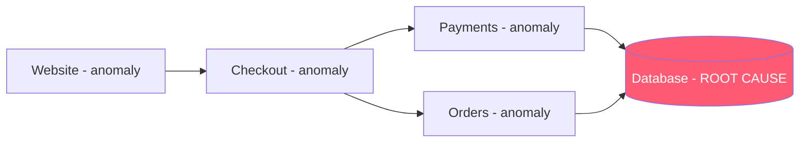
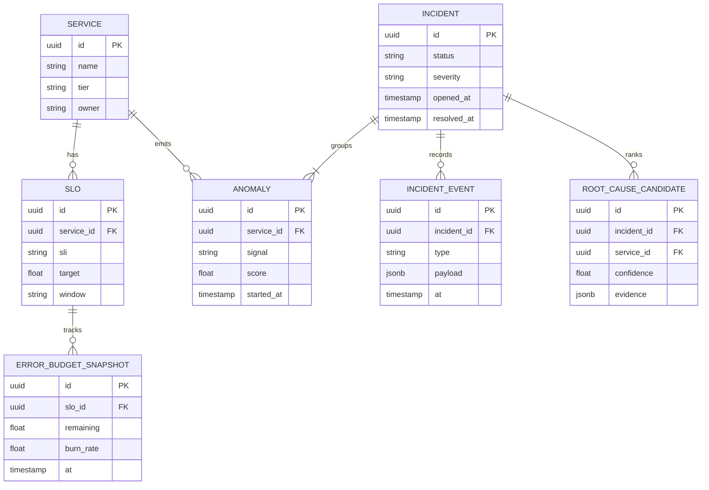
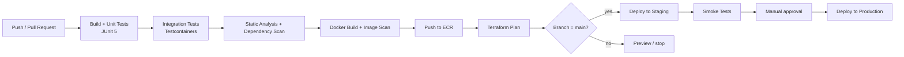

<div align="center">

# 🛰️ ReliabilityHub

### Distributed Incident Intelligence & SLO Management Platform

*Know what broke, why it broke, and what to fix, in seconds.*

                   

**[🌐 Live Demo & Website](YOUR_WEBSITE_LINK)** · **[📐 Architecture](#-architecture)** · **[🚀 Quick Start](#-quick-start)** · **[📡 API](#-api-reference)** · **[🧪 Testing](#-testing-strategy)**

<!-- Replace with a real GIF:  -->

</div>

---

## 📑 Table of Contents

1. [Overview (in plain English)](#-overview-in-plain-english)
2. [The Problem](#-the-problem)
3. [The Solution](#-the-solution)
4. [Key Features](#-key-features)
5. [Live Demo Walkthrough](#-live-demo-walkthrough)
6. [Architecture](#-architecture)
7. [Core Components in Detail](#-core-components-in-detail)
8. [Complete Tech Stack](#-complete-tech-stack)
9. [Kafka Topics & Event Contracts](#-kafka-topics--event-contracts)
10. [Anomaly Detection Engine](#-anomaly-detection-engine)
11. [Alert Correlation & Root-Cause Analysis](#-alert-correlation--root-cause-analysis)
12. [SLI / SLO, Error Budgets & Burn-Rate Alerting](#-sli--slo-error-budgets--burn-rate-alerting)
13. [Data Model](#-data-model)
14. [API Reference](#-api-reference)
15. [Observability Setup](#-observability-setup)
16. [Infrastructure & Deployment (AWS, Kubernetes, Terraform)](#-infrastructure--deployment)
17. [CI/CD Pipeline](#-cicd-pipeline)
18. [Testing Strategy](#-testing-strategy)
19. [Quick Start](#-quick-start)
20. [Configuration](#-configuration)
21. [Project Structure](#-project-structure)
22. [Security](#-security)
23. [Scalability & Reliability Design](#-scalability--reliability-design)
24. [Roadmap](#-roadmap)
25. [Contributing](#-contributing)
26. [License](#-license)
27. [Author](#-author)

---

## 🌍 Overview (in plain English)

Modern apps such as shopping sites, banking apps and ride-hailing apps are not one big program. They are **dozens of small services** that constantly talk to each other: one handles login, another handles payments, another stores orders.

When one of them breaks, the others start failing too, and **hundreds of alarms fire at once**. The engineer on call has to work out which alarm is the real problem, and every minute of guessing means unhappy customers and lost money.

**ReliabilityHub is like a smoke detector with a brain.** It watches every service, notices unusual behavior, merges related alarms into **one clear incident**, points at the **likely root cause**, and tracks a reliability promise (an *SLO*) so teams know how much failure is still acceptable.

> **Example:** The database slows down. Payments, Orders, Checkout and the Website all raise alerts.
> Without ReliabilityHub: 5 separate alarms and a confused team.
> With ReliabilityHub: **1 incident, "Root cause: Database,"** with the customer impact and a suggested next step.

---

## 🔥 The Problem

| Pain point | What happens today |
|---|---|
| **Alert storms** | One failing service triggers alerts across every service that depends on it. |
| **Slow root-cause discovery** | Engineers jump between metrics, logs and traces in separate tools. |
| **No priority** | A harmless blip and a revenue-killing outage look equally urgent. |
| **Reactive firefighting** | Teams notice a problem only after customers complain. |
| **Unclear reliability goals** | Without SLOs, "is the service reliable enough?" becomes an opinion. |

## 💡 The Solution

ReliabilityHub unifies **metrics, logs and traces** and adds an intelligence layer on top:

1. **Collect** telemetry from every service with OpenTelemetry.
2. **Detect** abnormal behavior with a Kafka-powered streaming engine.
3. **Correlate** related alerts into a single incident using the service dependency graph.
4. **Prioritize** incidents by customer impact and error-budget burn.
5. **Explain** the likely root cause and show the evidence.
6. **Protect** reliability with SLIs, SLOs, error budgets and burn-rate alerts.

---

## ✨ Key Features

### 🔭 Unified Observability
- Centralized **metrics** (Prometheus), **logs** (Loki) and **distributed traces** (Tempo).
- Vendor-neutral instrumentation through **OpenTelemetry**.
- One Grafana workspace with metric-to-trace and log-to-trace links (exemplars and trace IDs in logs).

### 🧠 Anomaly Detection
- Streaming detection on error rate, latency (p50/p95/p99), throughput and saturation.
- Seasonality-aware baselines, so normal daily peaks do not cause false alarms.
- Configurable sensitivity per service.

### 🔗 Alert Correlation
- Groups cascading failures into **one incident**.
- Uses the **service dependency graph** built automatically from distributed traces.
- Time-window and topology based clustering with deduplication.

### 🎯 Automated Prioritization & Root-Cause Analysis
- Severity scoring based on customer impact, service criticality and error-budget burn.
- Ranked list of root-cause candidates with supporting evidence (metrics, logs, trace samples).

### 📏 SLI/SLO Management
- Define SLIs (availability, latency, correctness) and SLOs (for example, 99.9% over 30 days).
- Real-time **error-budget** tracking.
- **Multi-window, multi-burn-rate alerting** to catch fast and slow degradation early.

### ☁️ Cloud-Native & Production-Ready
- Containerized with **Docker**, orchestrated on **Kubernetes (AWS EKS)**.
- Infrastructure fully described with **Terraform**.
- Automated build, test, scan and deploy with **GitHub Actions**.
- Integration-tested against real dependencies with **Testcontainers**.

### 🖥️ Modern Dashboard
- **React + TypeScript** UI with an incident timeline, service map, SLO overview and error-budget gauges.

---

## 🎬 Live Demo Walkthrough

The website includes an interactive 3D demo (an online shop under stress). It tells the same story as the real system:

| Step | What you do | What ReliabilityHub shows |
|---|---|---|
| 1 | Open the demo. All services are healthy. | Green map, 100% error budget. |
| 2 | Click **Break the database**. | The failure spreads to Payments, Orders, Checkout and Website. |
| 3 | Watch the alert counter rise. | Several alerts grouped into **1 incident**. |
| 4 | Read the incident card. | Plain-English impact plus the likely root cause: **Database**. |
| 5 | Watch the error budget. | The bar drains and the burn-rate warning appears. |
| 6 | Click **Fix everything**. | Services recover; the incident closes automatically. |

---

## 📐 Architecture

### High-level system



### From signal to incident



### Deployment topology



---

## 🧩 Core Components in Detail

| Component | Responsibility | Technology |
|---|---|---|
| **Telemetry Collector** | Receives OTLP data from services, batches, enriches and fans out to storage backends and Kafka. | OpenTelemetry Collector |
| **Ingestion Service** | Validates and normalizes events, attaches service metadata, writes to Kafka topics. | Java 21, Spring Boot, WebFlux |
| **Anomaly Detection Engine** | Consumes metric streams, maintains rolling baselines, emits anomaly events. | Java 21, Kafka consumers/streams |
| **Dependency Graph Builder** | Derives who-calls-whom from trace spans and keeps the graph fresh. | Java 21, Tempo queries, Redis |
| **Alert Correlation Engine** | Clusters anomalies into incidents and ranks root-cause candidates. | Java 21, Kafka |
| **SLO Engine** | Evaluates SLIs, error budgets and burn rates on a schedule. | Java 21, Prometheus API |
| **Incident Service** | System of record for incidents, timelines, SLOs; exposes REST and live streams. | Spring Boot, WebFlux, PostgreSQL, Redis |
| **Notification Service** | Sends incident and burn-rate alerts to Slack, email and webhooks. | Spring Boot |
| **Dashboard** | Incident timeline, service map, SLO and error-budget views. | React, TypeScript |

---

## 🛠️ Complete Tech Stack

### Backend & Application Layer
| Technology | Role in ReliabilityHub | Why it was chosen |
|---|---|---|
| **Java 21** | Primary language for all backend services. | Long-term support release with virtual threads, records, pattern matching and sealed types for clean, concurrent code. |
| **Spring Boot** | Application framework, configuration, dependency injection, actuator health endpoints. | Mature, production-proven ecosystem. |
| **Spring WebFlux** | Reactive, non-blocking REST and streaming endpoints. | Handles many concurrent connections and live incident streams efficiently. |

### Messaging & Streaming
| Technology | Role | Why |
|---|---|---|
| **Apache Kafka** | Event backbone for telemetry, anomalies, incidents and SLO alerts. | Durable, replayable, horizontally scalable; decouples detection from correlation. |

### Observability Stack
| Technology | Role | Why |
|---|---|---|
| **OpenTelemetry** | Standard instrumentation and collector for metrics, logs and traces. | Vendor-neutral; one SDK for all signals. |
| **Prometheus** | Time-series metrics storage and PromQL queries; source for SLIs. | Industry standard for cloud-native metrics. |
| **Grafana** | Dashboards and unified exploration across metrics, logs and traces. | Single pane of glass with cross-signal linking. |
| **Loki** | Log aggregation indexed by labels. | Cost-efficient, integrates natively with Grafana. |
| **Tempo** | Distributed trace storage. | Scales with object storage; trace-to-log/metric correlation. |

### Data Layer
| Technology | Role | Why |
|---|---|---|
| **PostgreSQL** | Persistent store for incidents, SLO definitions, error-budget history, audit logs. | ACID guarantees, JSONB for flexible evidence, strong tooling. |
| **Redis** | Caching of dependency graph and hot incident state; short-lived deduplication keys. | Sub-millisecond reads, TTL support. |

### Frontend
| Technology | Role | Why |
|---|---|---|
| **React** | Dashboard UI. | Component model suited to real-time views. |
| **TypeScript** | Type-safe frontend code and API clients. | Fewer runtime errors, better refactoring. |

### Cloud & Infrastructure
| Technology | Role | Why |
|---|---|---|
| **AWS (EKS, ECR, RDS, ElastiCache, S3, ALB, IAM)** | Cloud platform. | Managed Kubernetes and data services reduce operational load. |
| **Kubernetes** | Container orchestration, autoscaling, self-healing, rolling deployments. | Declarative, portable. |
| **Docker** | Packaging and local development. | Reproducible environments. |
| **Terraform** | Infrastructure as code for VPC, EKS, data services, IAM. | Versioned, reviewable, repeatable infrastructure. |

### CI/CD & Quality
| Technology | Role | Why |
|---|---|---|
| **GitHub Actions** | Build, test, scan, publish images and deploy. | Native to the repository, easy to review. |
| **JUnit 5** | Unit and parameterized tests. | Modern, extensible Java test framework. |
| **Testcontainers** | Integration tests with real Kafka, PostgreSQL, Redis. | Tests match production behavior without shared test environments. |

---

## 📨 Kafka Topics & Event Contracts

| Topic | Producer | Consumer | Key | Purpose |
|---|---|---|---|---|
| `telemetry.metrics.v1` | OTel Collector / Ingestion | Detection Engine | `serviceId` | Normalized metric samples |
| `telemetry.traces.v1` | OTel Collector / Ingestion | Dependency Graph Builder | `traceId` | Span summaries for topology |
| `anomalies.v1` | Detection Engine | Correlation Engine | `serviceId` | Detected abnormal behavior |
| `incidents.v1` | Correlation Engine | Incident Service, Notifications | `incidentId` | Incident lifecycle events |
| `slo.alerts.v1` | SLO Engine | Correlation Engine, Notifications | `sloId` | Burn-rate alerts |
| `*.dlq` | Any consumer | Operators | original key | Dead-letter queues for poison messages |

**Example anomaly event**

```json
{
  "eventId": "01HZX7K3...",
  "type": "ANOMALY_DETECTED",
  "serviceId": "payments",
  "signal": "error_rate",
  "observed": 0.18,
  "expected": 0.004,
  "score": 9.7,
  "windowStart": "2026-01-15T10:02:00Z",
  "windowEnd": "2026-01-15T10:03:00Z",
  "traceExemplars": ["4bf92f3577b34da6a3ce929d0e0e4736"]
}
```

Delivery guarantees: at-least-once with idempotent consumers (event IDs stored with TTL in Redis), partitioning by service for ordered per-service processing, and dead-letter topics for failures.

---

## 🧠 Anomaly Detection Engine

**Signals monitored per service:** request rate, error rate, latency percentiles (p50/p95/p99), saturation (CPU, memory, queue depth), and dependency call failures.

**Approach**

1. **Rolling baselines:** exponentially weighted moving average and variance per signal.
2. **Seasonality awareness:** compares against the same time window on previous days/weeks to avoid flagging daily peaks.
3. **Scoring:** a z-score style deviation, combined with a minimum absolute threshold to ignore tiny-traffic noise.
4. **Persistence rule:** an anomaly must hold for N consecutive windows before an alert is emitted, which reduces flapping.
5. **Cool-down:** repeated anomalies for the same signal are suppressed for a configurable period.

```text
score = |observed - baseline| / max(stddev, floor)
emit if score >= sensitivity AND persisted >= minWindows AND observed >= minAbsolute
```

All thresholds are configurable per service and per signal.

---

## 🔗 Alert Correlation & Root-Cause Analysis

When a dependency fails, every caller looks unhealthy. The correlation engine untangles this.

**Algorithm (simplified)**

1. **Collect** anomalies arriving within a sliding time window.
2. **Map** them onto the **service dependency graph**.
3. **Cluster** anomalies whose services are connected in the graph and whose start times are close.
4. **Rank root-cause candidates** using:
   - *Earliest onset:* the service whose anomaly started first.
   - *Downstream-ness:* services with many failing callers but no failing dependencies score higher.
   - *Evidence:* error-heavy traces, correlated log patterns and resource saturation.
5. **Score severity** from customer impact, service criticality and error-budget burn rate.
6. **Open or update** one incident; close it automatically after a stable recovery period.



**Result:** five alerts become one incident, "Root cause: Database," with ranked evidence.

---

## 📏 SLI / SLO, Error Budgets & Burn-Rate Alerting

### Definitions
- **SLI (Service Level Indicator):** a measurement, for example the ratio of successful requests.
- **SLO (Service Level Objective):** the target, for example 99.9% success over 30 days.
- **Error budget:** the allowed failure, `1 - SLO`. For 99.9% this is 0.1% of requests (about 43 minutes of full downtime per 30 days).
- **Burn rate:** how fast the budget is consumed relative to the allowed pace.

```text
error_budget      = 1 - SLO_target
burn_rate         = observed_error_ratio / error_budget
budget_remaining  = 1 - (errors_in_window / (total_in_window * error_budget))
```

### Example SLI (PromQL)

```promql
# Availability SLI: share of non-5xx requests
sum(rate(http_server_requests_seconds_count{service="payments",status!~"5.."}[5m]))
/
sum(rate(http_server_requests_seconds_count{service="payments"}[5m]))
```

### Multi-window, multi-burn-rate alerts

| Severity | Long window | Short window | Burn rate | Meaning |
|---|---|---|---|---|
| **Page (critical)** | 1 hour | 5 minutes | ≥ 14.4× | Budget would be gone in about 2 days; act now. |
| **Page (high)** | 6 hours | 30 minutes | ≥ 6× | Fast, sustained burn. |
| **Ticket** | 3 days | 6 hours | ≥ 1× | Slow burn that will exhaust the budget. |

Using two windows (long to confirm it is real, short to confirm it is still happening) keeps alerts precise and quick to reset after recovery.

### SLO definition example

```yaml
slos:
  - id: payments-availability
    service: payments
    sli: availability
    target: 0.999
    window: 30d
    alerting:
      burnRates: [14.4, 6, 1]
    owners: ["team-payments"]
```

---

## 🗄️ Data Model



PostgreSQL stores durable records; Redis caches the dependency graph and active-incident summaries.

---

## 📡 API Reference

Base URL: `/api/v1` · Format: JSON · Live updates: Server-Sent Events

| Method | Endpoint | Description |
|---|---|---|
| `GET` | `/incidents` | List incidents (filters: `status`, `severity`, `service`, `from`, `to`). |
| `GET` | `/incidents/{id}` | Incident details, timeline and ranked root-cause candidates. |
| `POST` | `/incidents/{id}/acknowledge` | Acknowledge an incident. |
| `POST` | `/incidents/{id}/resolve` | Resolve an incident with notes. |
| `GET` | `/incidents/stream` | SSE stream of live incident updates. |
| `GET` | `/services` | Services with health summary. |
| `GET` | `/services/graph` | Service dependency graph. |
| `GET` | `/slos` | List SLOs with current error-budget status. |
| `POST` | `/slos` | Create an SLO. |
| `GET` | `/slos/{id}/budget` | Error-budget history and burn rate. |
| `GET` | `/actuator/health` | Health and readiness probes. |

**Example response: `GET /incidents/{id}`**

```json
{
  "id": "inc_8f21",
  "status": "OPEN",
  "severity": "CRITICAL",
  "title": "Customers cannot complete payments",
  "alertsGrouped": 5,
  "rootCauseCandidates": [
    { "service": "database", "confidence": 0.91,
      "evidence": ["connection pool exhausted", "p99 latency 40x baseline"] }
  ],
  "impact": { "affectedServices": ["payments","orders","checkout","website"] },
  "errorBudget": { "remaining": 0.62, "burnRate": 14.8 }
}
```

---

## 🔭 Observability Setup

ReliabilityHub both **consumes** and **practices** observability.

- **Auto-instrumentation:** the OpenTelemetry Java agent is attached to every JVM service; no code changes needed for HTTP, JDBC and Kafka spans.
- **Metrics:** Micrometer exposes Prometheus metrics; RED metrics (rate, errors, duration) per endpoint.
- **Logs:** structured JSON logs containing `trace_id` and `span_id`, shipped to Loki.
- **Traces:** OTLP to the Collector, stored in Tempo with tail-based sampling that keeps error and slow traces.
- **Grafana:** pre-provisioned dashboards (service overview, Kafka lag, SLO and error budgets) and data-source links: metric exemplar → trace → related logs.
- **Self-monitoring:** ReliabilityHub monitors itself with its own SLOs (ingestion lag, detection latency, API availability).

---

## ☁️ Infrastructure & Deployment

### Terraform modules

| Module | Resources |
|---|---|
| `network` | VPC, public/private subnets, NAT gateways, route tables, security groups |
| `eks` | EKS cluster, managed node groups, OIDC provider, IAM roles for service accounts |
| `data` | RDS PostgreSQL (Multi-AZ), ElastiCache Redis, Kafka (Amazon MSK or Strimzi on EKS) |
| `storage` | S3 buckets for Loki and Tempo, lifecycle rules |
| `registry` | ECR repositories with image scanning |
| `edge` | ALB, ACM certificates, Route 53 records |

```bash
cd infra/terraform/envs/prod
terraform init
terraform plan -out tfplan
terraform apply tfplan
```

### Kubernetes

- Namespaces: `reliabilityhub`, `observability`.
- Workloads as Deployments with **readiness/liveness probes**, **resource requests/limits** and **PodDisruptionBudgets**.
- **Horizontal Pod Autoscaler** driven by CPU and Kafka consumer lag.
- **Rolling updates** with automatic rollback on failed health checks.
- Config via ConfigMaps; secrets via AWS Secrets Manager (External Secrets Operator).
- Managed with **Kustomize** overlays: `dev`, `staging`, `prod`.

```bash
kubectl apply -k deploy/overlays/prod
kubectl -n reliabilityhub rollout status deploy/incident-service
```

---

## 🔄 CI/CD Pipeline



**Workflows** (`.github/workflows/`)

| Workflow | Trigger | What it does |
|---|---|---|
| `ci.yml` | Pull request | Build, unit tests, integration tests, lint, dependency and container scans. |
| `release.yml` | Push to `main` | Build and push images to ECR, deploy to staging, run smoke tests. |
| `deploy-prod.yml` | Manual approval | Promote the tested image to production. |
| `terraform.yml` | Changes in `infra/` | Format check, validate, plan on PR; apply on merge. |

---

## 🧪 Testing Strategy

| Level | Tooling | What it covers |
|---|---|---|
| **Unit** | JUnit 5, Mockito, AssertJ | Detection scoring, burn-rate math, correlation logic, ranking rules. |
| **Integration** | JUnit 5 + **Testcontainers** | Real Kafka, PostgreSQL and Redis: topic flows, repositories, idempotent consumers, DLQ behavior. |
| **Contract** | Schema tests | Kafka event schemas stay backward compatible. |
| **End-to-end** | Docker Compose scenario runner | Inject a fault, assert one incident is created with the correct root cause. |
| **Frontend** | Vitest, React Testing Library | Components, SSE handling, accessibility checks. |
| **Chaos scenarios** | Fault injection scripts | Slow database, dead dependency, traffic spike, noisy neighbor. |

Example integration test idea:

```java
@Testcontainers
class CorrelationFlowIT {
  @Container static KafkaContainer kafka = new KafkaContainer(...);
  @Container static PostgreSQLContainer<?> pg = new PostgreSQLContainer<>("postgres:16");

  @Test
  void cascadingAnomaliesBecomeOneIncidentWithDatabaseAsRootCause() { /* ... */ }
}
```

```bash
./mvnw verify          # unit + integration tests
npm --prefix dashboard test
```

---

## 🚀 Quick Start

### Prerequisites
- Java 21, Maven (or use the included wrapper)
- Docker and Docker Compose
- Node.js 20+
- (Optional) Terraform, kubectl and an AWS account for cloud deployment

### Run locally

```bash
# 1. Clone
git clone https://github.com/<your-username>/reliabilityhub.git
cd reliabilityhub

# 2. Start infrastructure: Kafka, PostgreSQL, Redis, Prometheus, Grafana, Loki, Tempo, OTel Collector
docker compose -f deploy/local/docker-compose.yml up -d

# 3. Build and run the backend services
./mvnw clean install
./mvnw -pl services/incident-service spring-boot:run

# 4. Run the dashboard
cd dashboard
npm install
npm run dev
```

| Tool | URL |
|---|---|
| Dashboard | http://localhost:5173 |
| API | http://localhost:8080/api/v1 |
| Grafana | http://localhost:3000 |
| Prometheus | http://localhost:9090 |

### Try the fault-injection demo

```bash
./scripts/demo/inject-fault.sh --service database --mode slow
# Open the dashboard: several alerts appear as ONE incident with "database" as root cause
./scripts/demo/inject-fault.sh --clear
```

---

## ⚙️ Configuration

| Variable | Default | Description |
|---|---|---|
| `KAFKA_BOOTSTRAP_SERVERS` | `localhost:9092` | Kafka brokers |
| `POSTGRES_URL` | `jdbc:postgresql://localhost:5432/reliabilityhub` | Database URL |
| `REDIS_HOST` | `localhost` | Redis host |
| `PROMETHEUS_URL` | `http://localhost:9090` | Prometheus API for SLI queries |
| `OTEL_EXPORTER_OTLP_ENDPOINT` | `http://localhost:4317` | OTel Collector endpoint |
| `DETECTION_SENSITIVITY` | `3.0` | Anomaly score threshold |
| `CORRELATION_WINDOW_SECONDS` | `120` | Time window for grouping anomalies |
| `INCIDENT_AUTO_RESOLVE_MINUTES` | `10` | Stable time before auto-resolve |
| `SLACK_WEBHOOK_URL` | none | Notification webhook |

Per-service detection and SLO settings live in `config/services/*.yml`.

---

## 📁 Project Structure

```text
reliabilityhub/
├── services/
│   ├── ingestion-service/        # validates and normalizes telemetry
│   ├── detection-engine/         # anomaly detection on streams
│   ├── correlation-engine/       # clustering + root-cause ranking
│   ├── slo-engine/               # SLIs, error budgets, burn rates
│   ├── incident-service/         # REST + SSE, system of record
│   └── notification-service/     # Slack, email, webhooks
├── libs/
│   └── common/                   # event schemas, shared utilities
├── dashboard/                    # React + TypeScript UI
├── observability/
│   ├── otel-collector/           # collector pipelines
│   ├── prometheus/               # rules and scrape configs
│   ├── grafana/                  # provisioned dashboards
│   ├── loki/
│   └── tempo/
├── infra/
│   └── terraform/                # modules: network, eks, data, storage, registry, edge
├── deploy/
│   ├── local/                    # docker-compose for development
│   └── overlays/                 # Kustomize: dev, staging, prod
├── scripts/demo/                 # fault-injection scenarios
├── docs/                         # architecture notes, ADRs, screenshots
├── config/                       # per-service detection and SLO config
└── .github/workflows/            # CI/CD pipelines
```

---

## 🔐 Security

- **Authentication and authorization:** OAuth2/OIDC with role-based access (viewer, responder, admin).
- **Secrets:** stored in AWS Secrets Manager, never in Git.
- **Network:** private subnets for data stores, security groups with least privilege, TLS everywhere.
- **Workload identity:** IAM Roles for Service Accounts (IRSA) instead of long-lived keys.
- **Supply chain:** dependency and container image scanning in CI; pinned base images.
- **Audit:** all incident actions are recorded with user and timestamp.

---

## 📈 Scalability & Reliability Design

- **Horizontal scaling:** stateless services behind Kubernetes Services; scale on CPU and Kafka consumer lag.
- **Back-pressure:** reactive pipelines with WebFlux and bounded Kafka consumers.
- **Fault tolerance:** idempotent consumers, retries with exponential backoff, dead-letter topics, circuit breakers on outbound calls.
- **High availability:** Multi-AZ databases, multiple replicas, PodDisruptionBudgets, topology spread constraints.
- **Data lifecycle:** retention policies on Kafka, Loki and Tempo; downsampled long-term metrics.
- **Observability of itself:** ReliabilityHub defines SLOs for its own ingestion latency, detection delay and API availability.

---

## 🗺️ Roadmap

- [ ] Machine-learning anomaly scoring (Isolation Forest / Prophet-style forecasting)
- [ ] Slack and PagerDuty two-way incident management
- [ ] Automated postmortem draft generation
- [ ] Runbook automation and one-click remediation
- [ ] Multi-tenant support
- [ ] Change-event correlation (deploys, feature flags) as root-cause signals
- [ ] Cost and capacity insights

---

## 🤝 Contributing

Contributions are welcome.

1. Fork the repository.
2. Create a branch: `git checkout -b feature/my-feature`.
3. Commit with clear messages and add tests.
4. Run `./mvnw verify` and `npm test`.
5. Open a pull request describing the change and why.

Please read `CONTRIBUTING.md` and follow the code of conduct.

---

## 📄 License

Distributed under the MIT License. See `LICENSE` for details.

---

## 👤 Author

**Your Name**
[LinkedIn](YOUR_LINKEDIN) · [GitHub](https://github.com/<your-username>) · [Portfolio](YOUR_WEBSITE_LINK) · your.email@example.com

<div align="center">

⭐ If ReliabilityHub helped you, please star the repository. ⭐

</div>
